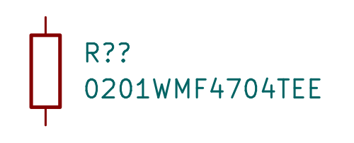

# 0201WMF4704TEE / C778408

Change the 4.7 MΩ resistor from 0402 to 0201; preserve 1% tolerance. JLC7222pieces observed2026-10-17. Exact linked Uniroyal English family PDF: orderingcodep2, dimensions/powerp4, voltage/temperaturep5.50mW at70°C,25V,−55..155°C; maximum body.63×.33×.26mm. Full5V dissipation5.4µW.

Downloaded exact C778408 lands and STEP match already checked shared0201 geometry. New footprint retains their dimensions underUniohmname; model seating corrected to0/0/0, imported extra paste omitted. Footprint/native3D images andDRC explicitly reused unchanged fromgeometryfixture. This is a generic unmarked package model. JLC land pattern and denseflexassembly need supplierprocessacceptance.

Checks: new symbol rendered and inspected; full library datasheet gate 233 OK, 52 unrelated existing findings; full model gate one existing missing R0603.step reference and no new seating defects; publication gate passed.
