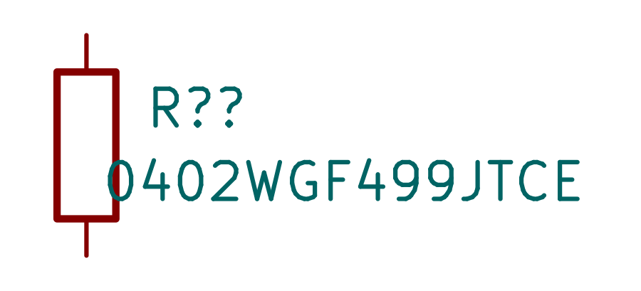
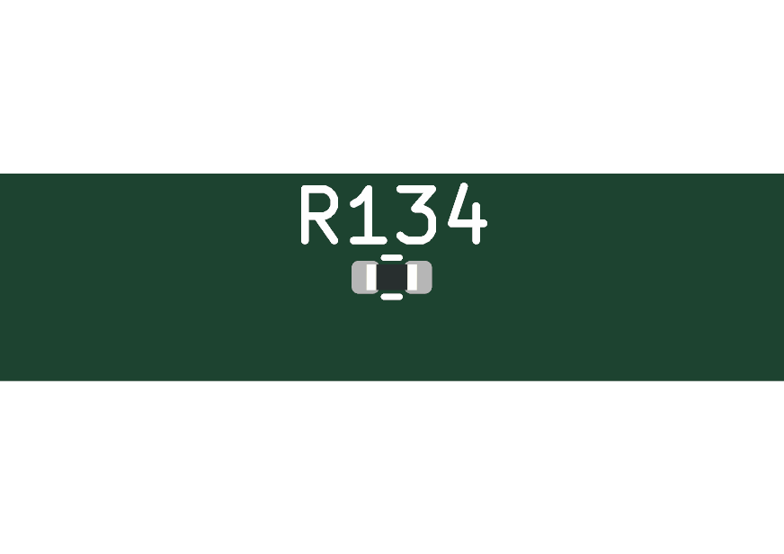
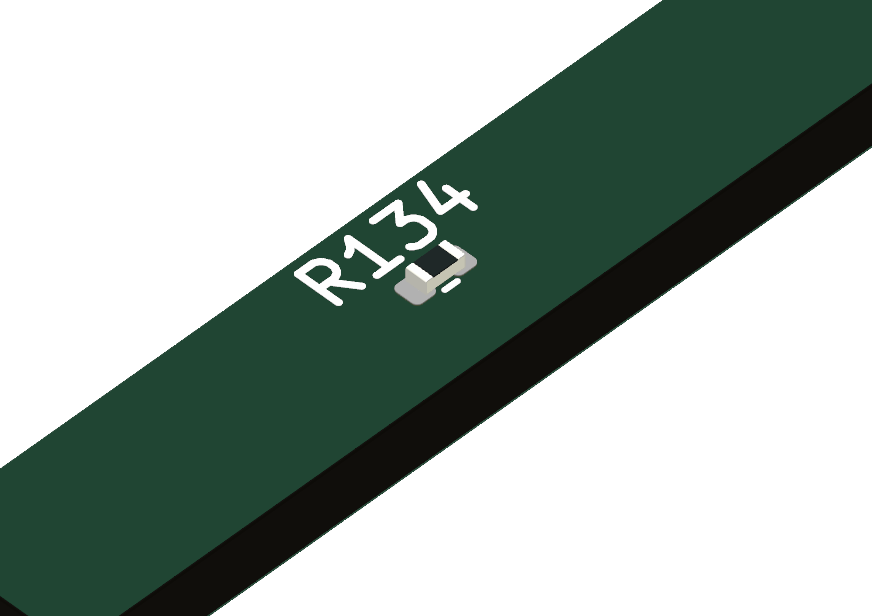

# 0402WGF499JTCE — C25120

Added the exact 49.9Ω ±1% UNI-ROYAL0402 symbol and local English family datasheet. Live JLC stock 1,251,880; SMT/basic. Existing0402 footprints/model reused unchanged; two passivepins match pads1/2. Exact CAD download retained as source in project work; its oversized paste graphics / legacy format were not merged.

**Package:** manufacturer Feb 12, 2019 V3 pp4–5:body 1.00±.10×.50±.05×.35±.05mm;62.5mW through70°C, linear derating to155°C. Dense placed lands .54×.64 at±.51mm differ from recommended nominal lands; existing JLC dense assembly approval hold remains. Model is simplified generic 0402, not exact manufacturer CAD. Front/top/isometric renders inspected.

**Gate loading:** Hottech IRLML6244 Qg 8.9nC is typical at VGS 4.5V, not a maximum. At5.25V/40kHz, Qg×V×f≈1.87mW is an estimate only. A separate engineering envelope of ≤50nC actual charge per edge and ≤40kHz gives conservative2VQf≤21mW, plus14µW pulldownloss;100°Cderatedrating40.44mW. Verify actual waveforms / charge before claiming this envelope. No firmware PWM frequency was previously specified.

**Pulse limitation:** ideal initial 5.25Vstep/49.401Ω bounds current 106mA and momentary resistor power 558mW; driver impedance reduces both. Catalogue 50V is not usable continuous voltage across49.9Ω. Published 5s short overload test(~4.39V) is not a repetitive submicrosecond pulse rating; no such pulse curve identified. Average power supports a 0402 prototype selection, but repetitive pulse reliability remains conditional on waveform / vendor qualification. This is not an unconditional production PASS.

**Checks:** exact symbol native parse PASS; detached 34-sheet schematic ERC 0; no schematic wire / pin changes. NDA all-scope PASS. Shared model check has0 new seating defects but one pre-existing missing STEP in an unrelated download report; datasheet global gate retains unrelated existing failures. Exact part datasheet, 1/2 pin parity, and model path resolve. No global settings changed.

Source: [JLC detail](https://cart.jlcpcb.com/shoppingCart/smtGood/getComponentDetail?componentCode=C25120). Exact distributor datasheet link returned HTML; reused already archived manufacturer family PDF covering ordering code and package/rating. Raw stock and conditional screen in adjacent JSON.

