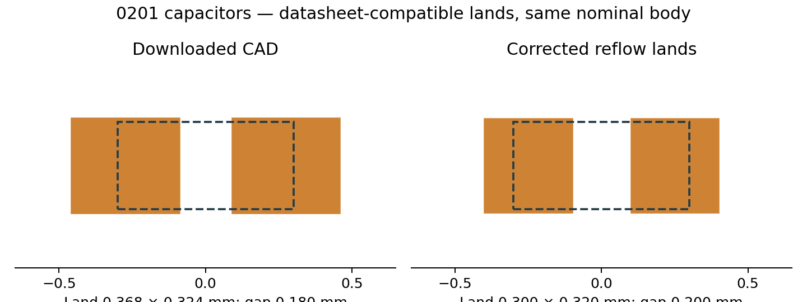
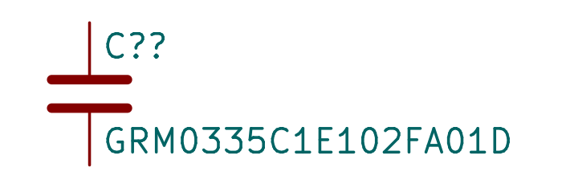
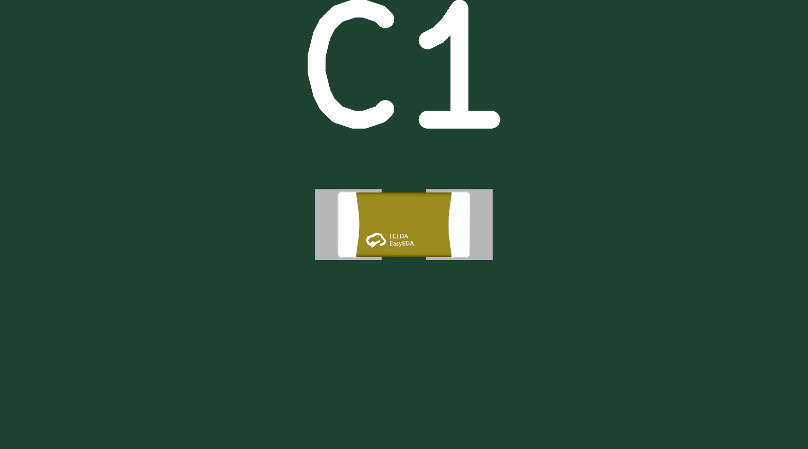

# C6/C7 0201 capacitor alternatives

- **GRM0335C1E102FA01D / C1864327:** 1 nF, C0G, 25 V, ±1%; Murata exact series specification page1, reflow-land table printed page26.
- **CL03C100JB3GNNC / C2991796:** 10 pF, C0G, 50 V, ±5%; Samsung catalog exact CL03C100JB3GNN# table printed page05, dimension table and final reflow-land table. Both preserve receiver capacitance/dielectric.
- Live JLC stock evidence: 5398 / 6486 units respectively on2026-10-16; availability can change. Both listed SMT assembly eligible.

Downloaded exact-SKU CAD first. Corrected the imported symbol (mislocated graphics/pins) using the existing verified passive capacitor symbol; pins1/2 retained. Corrected oversize JLC lands0.3684×0.324mm/gap0.1802 to shared manufacturer-compatible **0.30×0.32mm lands,0.20mm gap**. Removed duplicate paste artwork. Corrected generic STEP seating from−0.15mm to0mm using a+0.15mm model offset. No polarity.

Native fixture: zero padstack, shorts, copper-clearance, edge or courtyard errors; zero opens. One reference-text-height warning is unrelated to copper. Numeric STEP bounds and inspected native top/side renders confirm seating. Generic JLC model represents nominal0.60×0.30×0.305mm body and terminals; markings are illustrative.

Shared-library gates: NDA scan passes; new part model units/transform/seating pass. Full model audit retains one pre-existing missing model in reports/0603WAF820JT5E/downloaded-footprint.kicad_mod. Datasheet audit records these two English PDFs; unrelated pre-existing findings remain.

**Assembly hold:** these source-compatible lands and stock records do not approve the final dense flex coverlay windows or establish JLC process acceptance. The footprint is a candidate until installed and fully routed/checked in the actual board.

