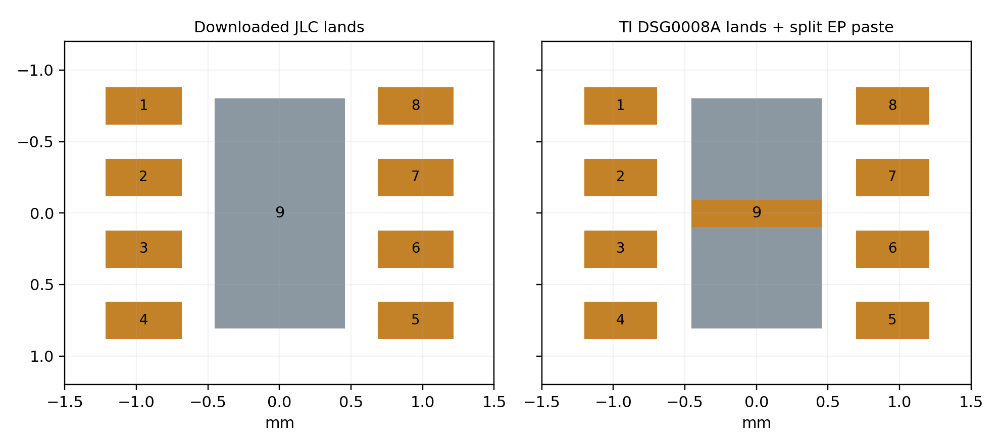
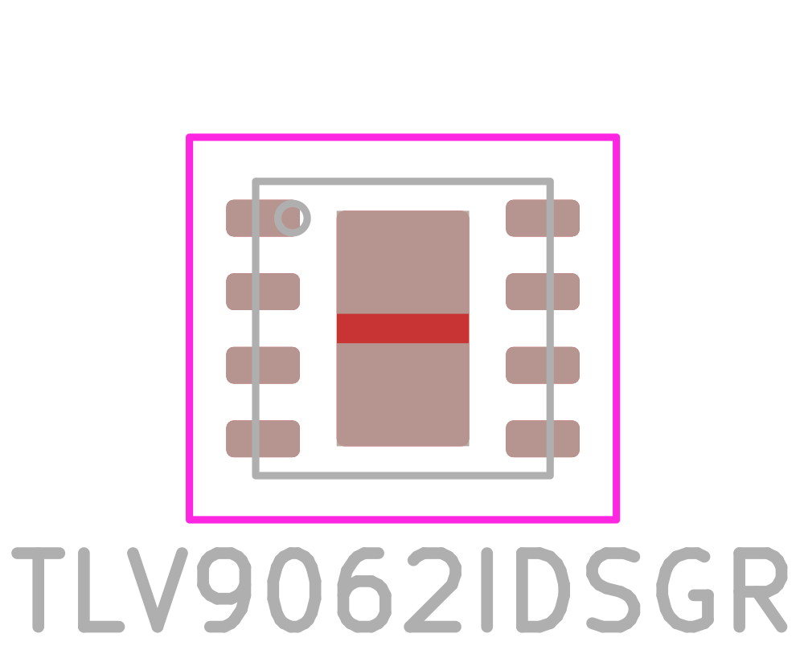
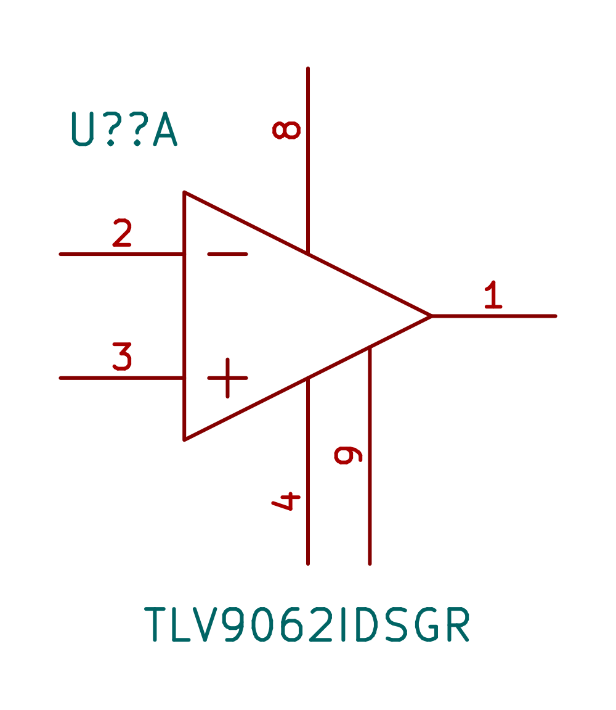
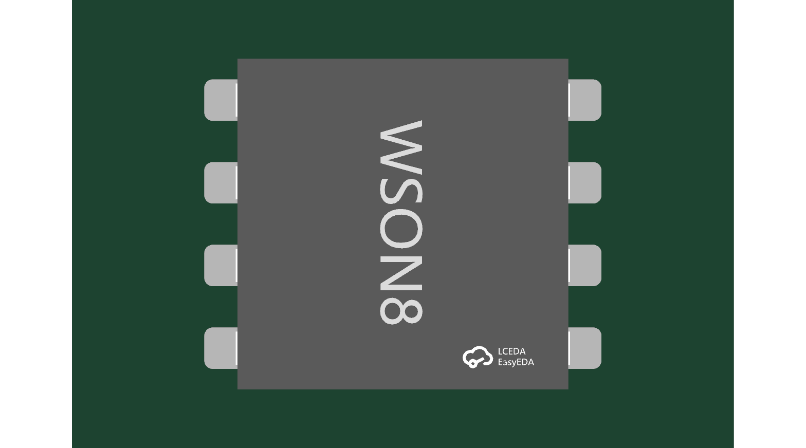

# TLV9062IDSGR — smaller receiver amplifier

Same TLV9062 electrical function and pins1–8 as the previous DGK part. WSON2×2mm package,0.8mm maximum height. **New exposed pad9 must connect to V−/GND.** TI SBOS839N July2026 Figure5-7 and Table5-3 are the pin authority. Public local English PDF is`${KSL_ROOT}/datasheets/TLV9062IDSGR.pdf`.

JLC C2058009:2079 units, SMT eligible, checked2026-10-16; stock can change. DDF alternative C2867884 had only2 units against5 minimumassemblyquantity and was rejected for availability.

Downloaded exact-SKU CAD before editing. Corrected the JLC signal lands0.521006×0.250013 to TI DSG0008A4218900/E08/2022 example0.50×0.25mm at0.50mm pitch and1.90mm row centres. EP stays0.90×1.60mm. Split its original full paste into two0.90×0.70mm apertures,87.5% nominalcoverage (TI87% rounded,0.125mm stencil example). No thermal vias; TI says optional. Final assembly stencil still requires vendor qualification.

Symbol reuses the verified original1–8 geometry and adds visibleEPpin9. New generic courtyard2.90×2.60mm; no altered body or lands to obtain room. Native distinct-net9pad fixture: zero copper shorts/clearance, padstack or courtyard errors; zero opens. Only reference-text height/edge diagnostics remain.

JLC generic STEP is seated atZ0 and aligned to terminalrows; top/side renders inspected. Its illustrated height0.811mm exceeds the source0.8mm envelope by11µm. It is retained as a conservative visual model, not exact manufacturer mechanical CAD. Use datasheet0.8mm maximum for dimensional requirements.

This part proof does not qualify the dense flex coverlay or establish complete routing. Source instance must preserve+.10mm pad mask expansion and native absolute pad orientation.

