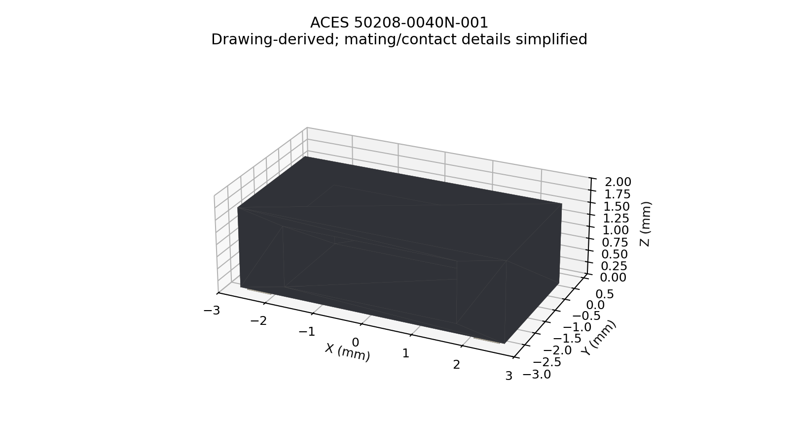

# ACES 50208-0040N-001 — four-way fan connector model

The existing footprint now references a simplified STEP model built from the
four-circuit dimensions in `datasheets/50208-0040N-001.pdf`, revision AA, page 1.
The symbol, copper pads and footprint placement are unchanged.

The model has a 5.38 × 2.70 × 1.70 mm body, 0.8 mm contact pitch and 4.64 mm
fitting-nail centre spacing. Its terminal plane is Z=0; model X equals footprint
X and model Y is the negative of footprint Y. Pin 1 is X=-1.2 mm. The cable
opening faces footprint +Y. The footprint uses zero offset/rotation and unit
scale. All seven solids pass the CAD-kernel validity check and the exported
STEP is reopened and checked by the generator.

This is **drawing-derived, not manufacturer CAD**. The cavity, contact springs
and fitting-nail details are simplified. The drawing's B dimension is a mating
datum, not a guaranteed internal cavity width. This model is useful for body
placement; it does not qualify mating plugs, wires, latch travel or insertion
clearance. A manufacturer download was found behind an agreement, which was
not accepted; no manufacturer ZIP was used.



From the library root, rebuild with Python 3.12 and uv:

```sh
uv run --with cadquery-ocp==8.0.1.1.0 python docs/part-reports/ACES50208-0040N-001/build_model.py
uv run --with matplotlib==3.10.7 python docs/part-reports/ACES50208-0040N-001/render_model.py
```

`validation.json` records the source and output SHA-256, dimensions, bounds and
assumptions. STEP headers contain timestamps, so regenerated bytes may differ
while the geometry remains identical.
