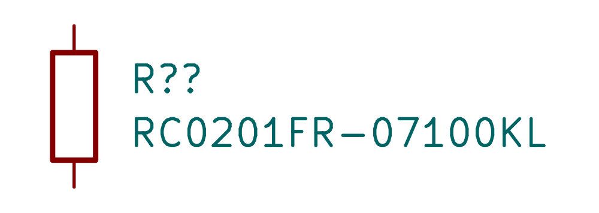

# RC0201FR-07100KL / C106224

100 kΩ ±1%, 0201, 50 mW at 70°C, 25 V limiting voltage. Exact public English Yageo specsheet p1; maximum body 0.63×0.33×0.26 mm. Live JLC stock is saved in JLC-live.json.

Exact downloaded lands and STEP match the verified shared RC0201 asset. Keep corrected 0/0/0 model seating and simple paste apertures. The unmarked model, footprint images and native fixture DRC are explicitly reused unchanged. New symbol rendered independently.

At 5.25 V across the full resistor, worst −1% loss is 0.279 mW, under its 50 mW rating at 70°C. Temperature derating still applies. Dense flex assembly acceptance remains a supplier check.

Checks: symbol rendered and inspected; same exact footprint/model as preceding full model gate (one unrelated missing R0603.step reference). Datasheet gate235 OK,52 unrelated existing findings; publication gate passed.
