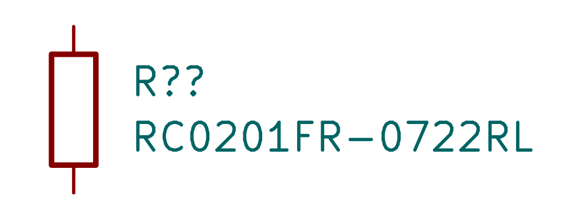
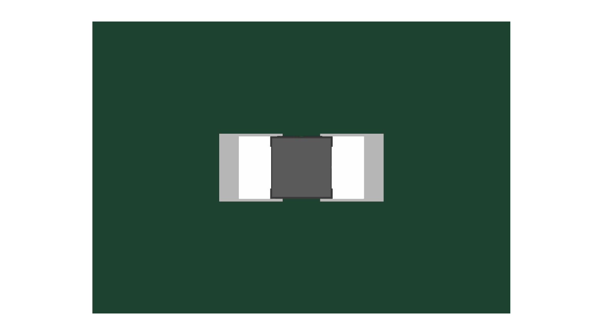

# RC0201FR-0722RL / C155743

22 Ω ±1%, 0201, 50 mW at 70°C, 25 V limiting voltage. JLC stock 1,049,561 observed 2026-10-17. Exact English manufacturer specsheet p1; maximum body 0.63×0.33×0.26 mm.

Exact downloaded lands and STEP match the verified shared RC0201 asset. Keep corrected 0/0/0 model seating and simple paste apertures. The unmarked model, footprint images and native fixture DRC are explicitly reused unchanged. New symbol rendered independently.

At 10 mA, loss is 2.22 mW. Input-filter startup is **not qualified** by this steady-state result: an ideal 5.25 V step into 4.7 µF gives about 1.27 W initially, 65 µJ stored energy and a 102 µs RC time constant. The available manufacturer RC specification has no suitable pulse curve. Check the real supply ramp / turn-on pulse before production use in this position.

Checks: new symbol rendered and inspected; exact footprint/model unchanged from preceding full model gate (one unrelated R0603.step reference missing). Datasheet gate 234 OK with 52 unrelated existing findings; publication gate passed.
