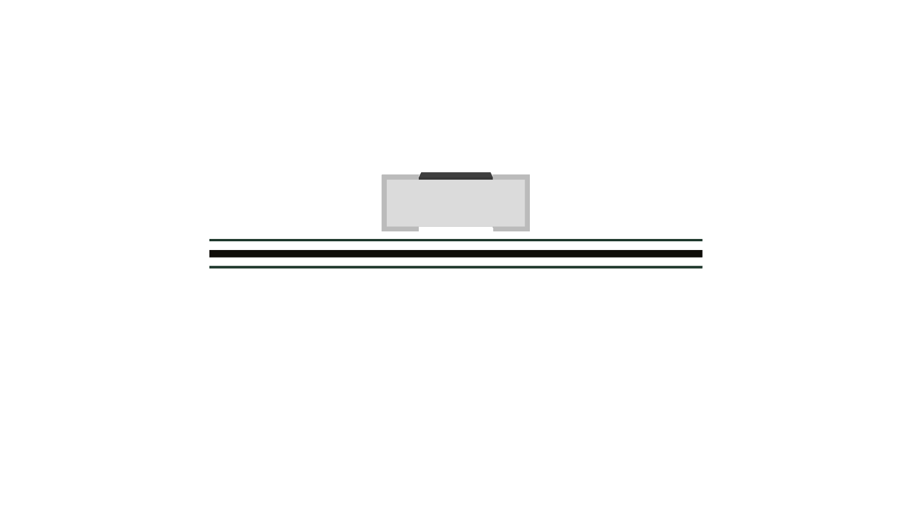
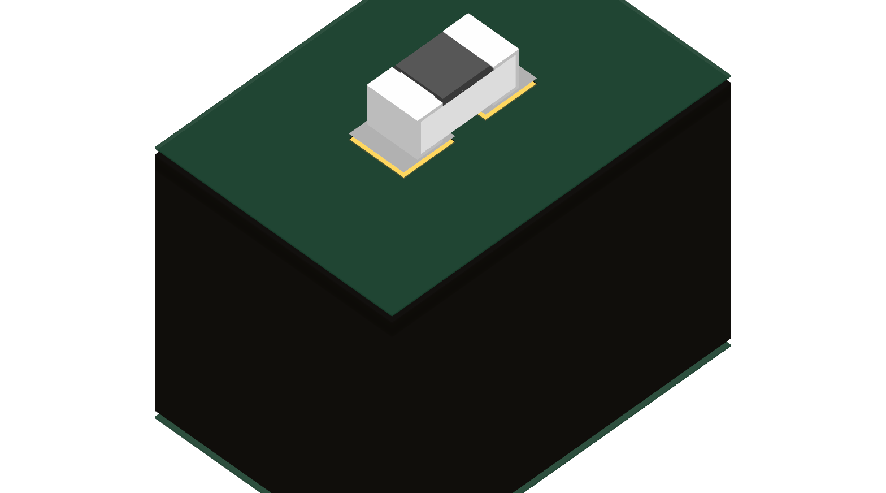
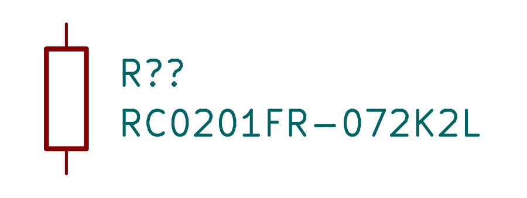

# RC0201FR-072K2L / C142018 — compact 2.2 kΩ pull-up

Exact Yageo 0201 resistor: 2.2 kΩ ±1%, 50 mW at70°C, 25V maximum continuous, −55..125°C. Maximum body0.63×0.33×0.26mm. R1010 dissipates at most1.8mW for1.98V and−1% resistance.

JLC observed stock1,119,844, SMT process,2026-10-16. Exact CAD downloaded before reuse. Its lands and STEP are identical to the qualified R_0201_Yageo_RC assets. Reuse their corrected zero model offset, simple paste apertures and stable two-pin passive symbol. Exact manufacturer English PDF stored locally.

Native fixture DRC and images below are explicitly reused from the10k member because copper/model geometry is identical, not represented as an independently rendered2.2k marking. Model is generic, nominal, unmarked; max source dimensions checked separately. Supplier approval remains necessary for dense flex assembly.

Shared-library gates: NDA scan passes. Model gate has no newpart fault; one existing unrelated missing model reports/0603WAF820JT5E/R0603.step remains. Datasheet verification resolves this exact English PDF; unrelated pre-existing global findings remain.

