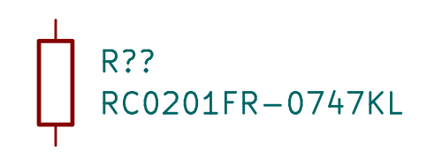

# RC0201FR-0747KL / C138139

47kΩ ±1%, 0201, 50mW at70°C, 25V limiting voltage. Exact public Yageo English specsheet page1; maximum body0.63×0.33×0.26mm. JLC observed stock577,441 on2026-10-17, SMT-listed.

Exact downloaded lands and STEP match shared RC0201 assets. Reuse corrected model origin0/0/0 and simple paste apertures. Shared native fixture DRC and footprint/top/front/isometric images below are explicitly reused because geometry is identical. New exact-part symbol rendered independently. Model is nominal and unmarked. Dense flex assembly and coverlay remain supplier acceptance items.

Full5V resistor dissipation: 0.537mW at−1% resistance. R1006 normal midrail feedback bound at5.25V supply:6.96mW; full-rail fault and hot derating require separate review.

