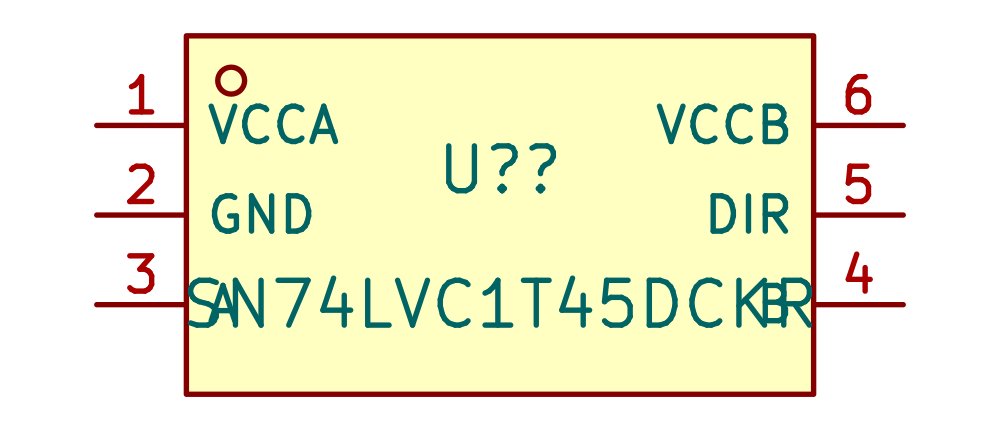
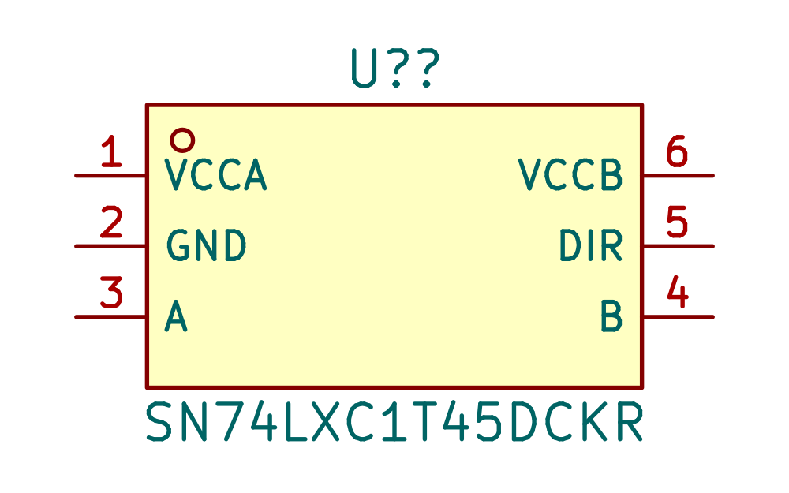
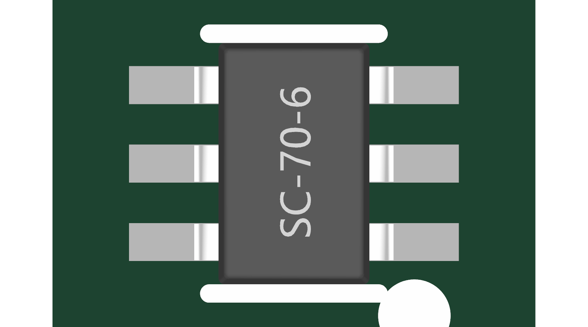
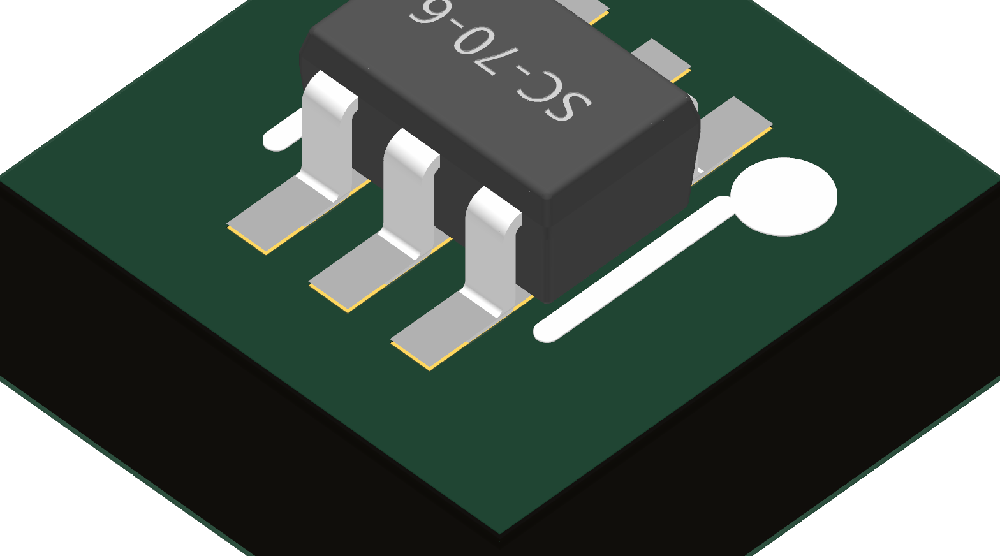

# Replace the 1.65 V translator with a 1.1 V part

SN74LXC1T45DCKR (C5217888) was added to Interface_KSL. It replaces U900's SN74LVC1T45DCKR without changing the approved DCK0006A lands, model, or pin positions. Ground rise along the flex erodes a connector-supplied 1.8 V rail; the new part provides more supply margin.

- Source: public [TI SCES934A](https://www.ti.com/lit/ds/symlink/sn74lxc1t45.pdf), English, pages 3–8 and DCK0006A package appendix. Local link: `${KSL_ROOT}/datasheets/SN74LXC1T45DCKR.pdf`.
- Both rails support 1.1–5.5 V. Pin order: 1 VCCA, 2 GND, 3 A, 4 B, 5 DIR, 6 VCCB. Recommended output drive is 32 mA at 4.5 V; this is not a current limiter. The 49.9 ohm gate resistor remains.
- Power-off/floating-supply isolation is specified. Input absolute range is −0.5 to 6.5 V; recommended input range begins at zero. Saved-copper ground offset must still be checked; absolute-limit clearance does not qualify negative-input operation.
- JLC API returned 4,547 units on 2026-10-17. Refresh inventory and assembly quotation before purchase. LCSC API returned HTTP403; no stock claim was inferred from it.
- Downloaded EasyEDA CAD was inspected. Its symbol referenced an unrelated PDF; this was corrected. The existing verified DCK package was reused. Only symbol identity, metadata and label positions changed. The model is a generic package representation, not exact device marking.
- Native symbol loading, exact six-pin mapping, top/front/isometric visual placement, and local datasheet checks passed. Detached project integration preserved all 2,562 native pin/net tuples and every PCB non-property record. No U900 ERC errors; the template retained 18 unrelated pre-existing symbol mismatches pending final library reconciliation.
- Broad gates: NDA passes; model seating has zero new failures, but four unrelated imported-report artifacts fail global units/transform checks. Datasheet gate has 237 passes and 57 unrelated unresolved library records. No exceptions were added to hide them.

Before / after symbol labels (electrical pin geometry unchanged):

Unchanged package placement:

