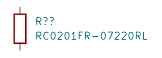
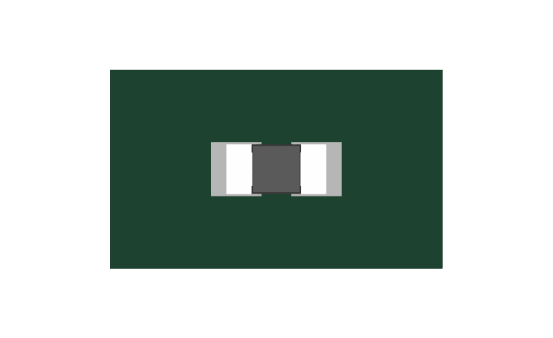
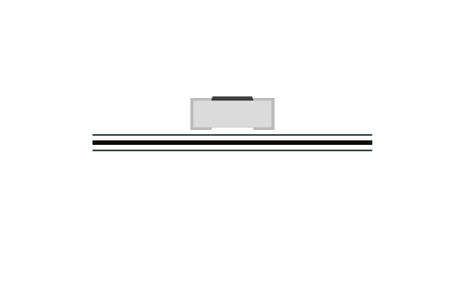
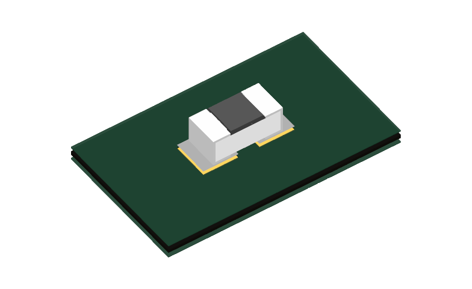

# RC0201FR-07220RL — R134 gate resistor

220 Ω ±1%, Yageo RC0201, LCSC/JLC C274342. JLC snapshot: 214,652 available on 2026-10-17 at 21:25 China time; stock is not reserved.

The public English manufacturer RC-series datasheet, V14 dated 2025-11-14, is stored as `${KSL_ROOT}/datasheets/RC0201FR-07220RL.pdf`. The ordering system identifies the exact variant. RC0201 body is 0.60 ±0.03 × 0.30 ±0.03 × 0.23 ±0.03 mm (p4), rated 50 mW at 70°C, 25 V maximum working and 50 V maximum overload (p5). Power derates above 70°C; do not treat that rating as temperature-independent. The exact distributor PDF URL returned an access-denied page; the stored PDF is the authentic manufacturer family document.

Downloaded C274342 symbol, footprint and model with JLC2KiCadLib before using the existing qualified `R_0201_Yageo_RC` footprint/model. Downloaded lands match the canonical copper exactly: pads 0.303124 × 0.324003 mm, centers ±0.241554 mm. Existing symbols and footprint/model files are unchanged. Canonical Fab uses maximum body size; the existing nominal 3D resistor is an illustrative package model, not a dimensional assembly guarantee. Top, front and isometric native KiCad renders and symbol view were inspected: centered lands, correct zero-offset seating and visible terminals.

For this gate circuit, 220 Ω −1% limits an ideal 5.25 V step to 24.11 mA. Using the MOSFET's typical 8.9 nC gate charge gives about 46.7 nJ per cycle, 0.94 mW at 20 kHz or 4.67 mW at 100 kHz, plus approximately 0.06 mW DC pulldown loss. These are typical switching estimates, not a guaranteed frequency limit. A 5.5 V pulse is below the datasheet's 2.5× rated-voltage short-time-overload test level, about 8.29 V for 220 Ω/50 mW; that test does not independently qualify arbitrary repetitive pulses. Actual PWM edges should be verified on hardware.

Datasheet gate: 240 OK, 57 unrelated existing findings. Model text gates: four unrelated existing imported-file findings. The reused resistor model was visually verified here; no new model transform was introduced. Public/NDA tree gate passed. Pin numbers, downloaded lands and all previous symbol preservation checks passed (`verification.json`). No new global waiver.

