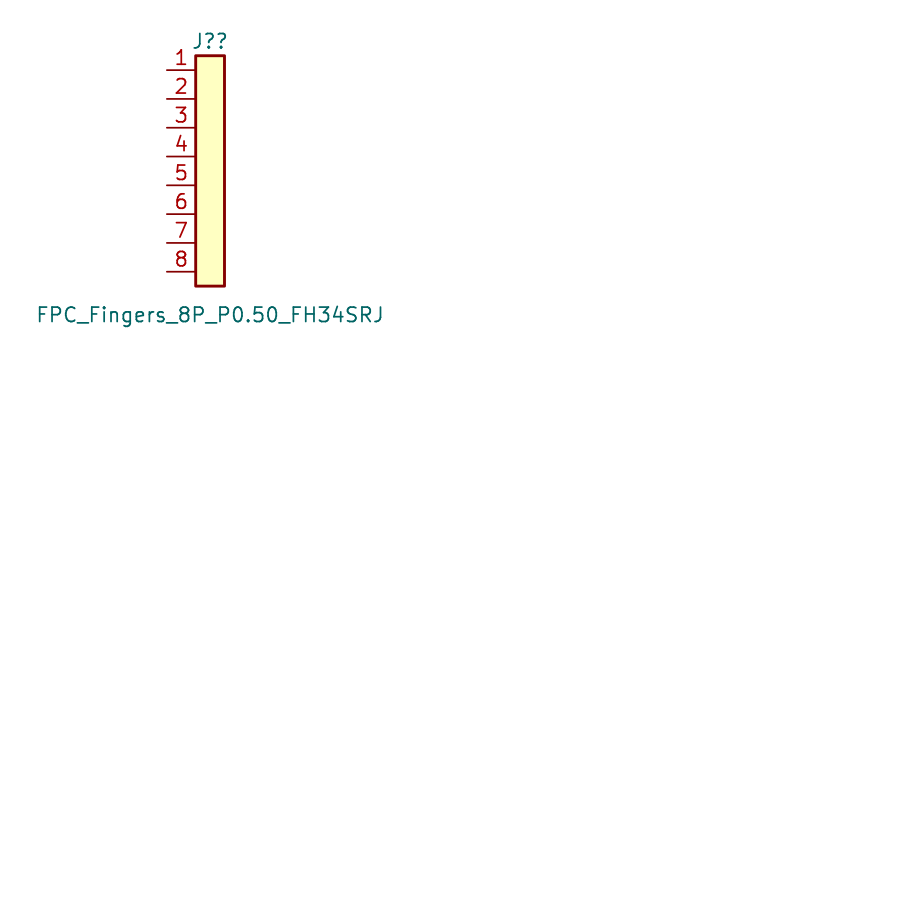
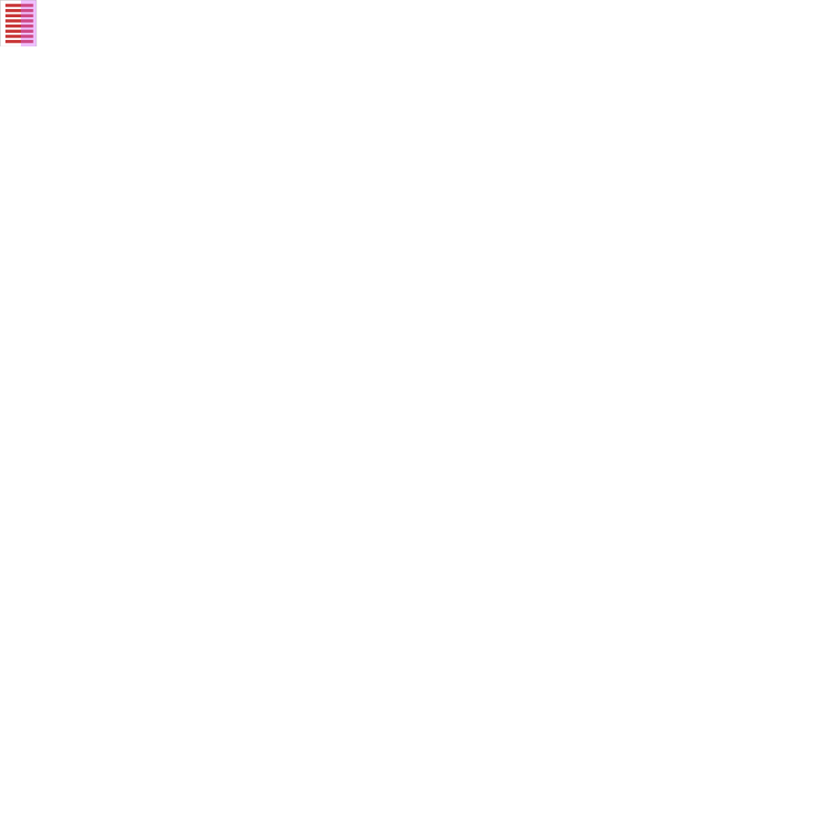
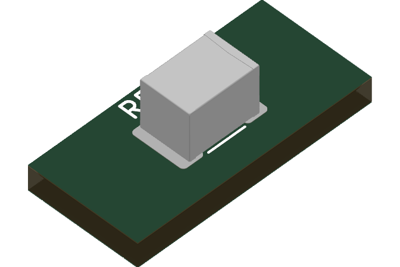
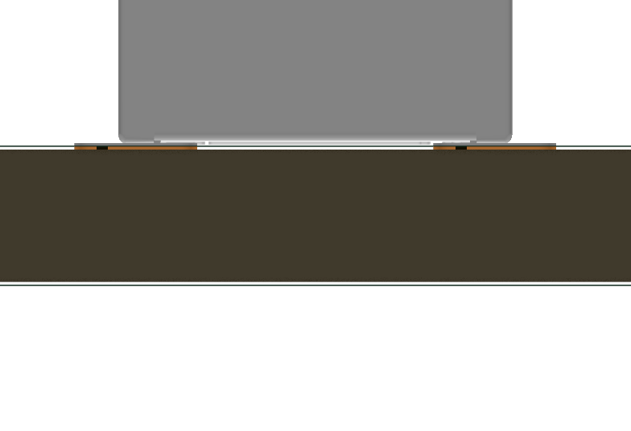
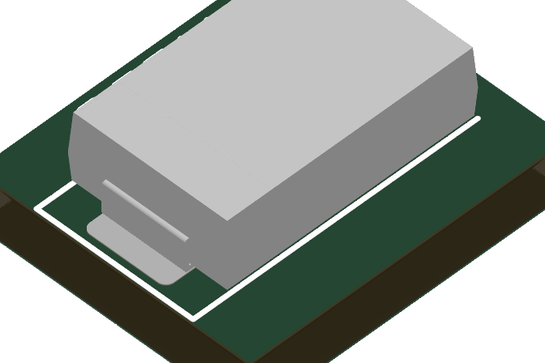
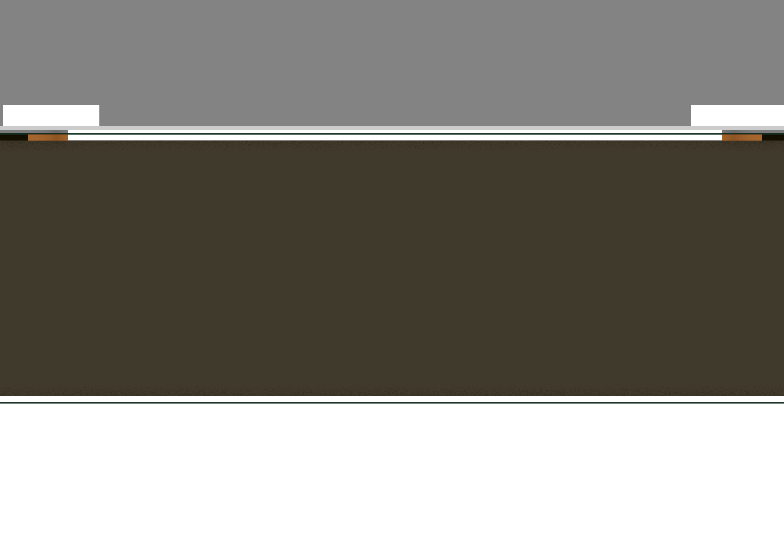
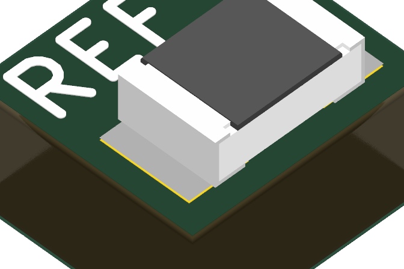
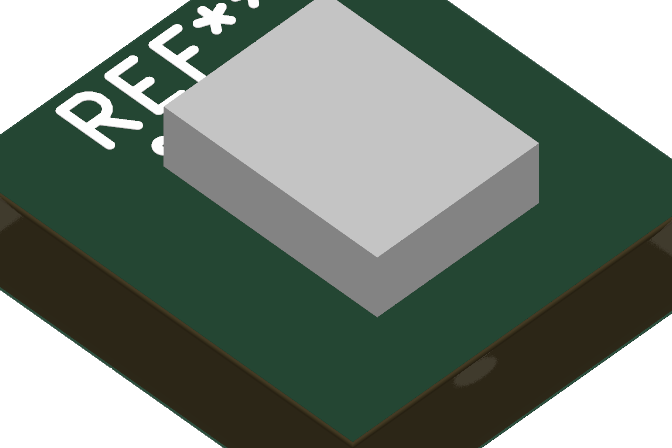

# Cube board parts into KSL — 2026-10-31

The Cube boards (Audio, V3 Power Breakout, LED strip, Wheel flex, LED bar) used parts that lived only in a project's
`libraries/` folder, or only embedded in a board or schematic. Step 0 (search every name in KSL, KNL, `_attic` and git
history) split them into three groups:

- **Already in KSL** under another name or library. Nothing is added; the boards need repointing.
  - TLV3502AIDCNR is in `Amplifier_Comparator_KSL`, not `Interface_KSL`.
  - XL-1010RGBC-2812B, CL05A475MP5NRNC and GRM033R61E104KE14D are already in KSL.
  - TestAccess `ProbePad_D1.0mm` is the same copper as `TestPoint_KSL:TestPoint_Pad_D1.0mm_KSL`: a Ø1.0 pad with a
    coverlay opening.
  - The `_Functional` symbol redraws (TAS2781RYYR, TLV62569DBVR, TPS62933FDRLR, TPS7A2018DQNR, TPS25730DREFR,
    TPS259470LRPWR) are project-specific aliases of KSL symbols that already exist. They stay project-local, per
    kicad-parts.
- **Added here** (below).
- **Kept board-local:** `Wheel_Flex:Wheel_Segment_Swirl_R6-15.5_120deg`. It's the wheel's electrode copper, not a
  component.

All LCSC codes were read from LCSC's product API on 2026-10-31 (part number, maker and package confirmed). Every
datasheet is a local PDF under `${KSL_ROOT}/datasheets/`.

## Added

| Part | Library | Footprint | LCSC | Datasheet | Notes |
|---|---|---|---|---|---|
| FS43X226K500ERG (PSA, 22 µF 50 V X7R 1812) | Capacitor_KSL | **C1812_PSA** (new) | C22388553 | local, English | Thickness code R = 3.10 ±0.30 mm (Table 8) |
| GRM155R71H104KE14D (Murata, 0402) | Capacitor_KSL | C0402 | — not listed on LCSC | local, English | |
| GRM188R61C106KAALD (Murata, 10 µF 16 V X5R 0603) | Capacitor_KSL | C0603 | C86275 | local (LCSC copy), English | Murata's own URL now 404s |
| GRM188R70J105KA01D (Murata, 0603) | Capacitor_KSL | C0603 | C19375168 | local, English | |
| JMK107BB7475MA-T (Taiyo Yuden, 0603) | Capacitor_KSL | C0603 | C2171177 | local, English (incidental CJK) | |
| CA55-H035M686TE070 (Xiangyee, 68 µF 35 V polymer Ta, H case) | Capacitor_KSL | **CA55-H035M686TE070** (new) | C51822205 | local, bilingual with complete English | H case 7.30 × 4.30 × 2.10 ±0.30 mm |
| CL05B103KB5NNNC (Samsung, 0402) | Capacitor_KSL | C0402 | C15195 | local, English (series catalogue) | |
| CL31B475KBHNNNE (Samsung, 1206) | Capacitor_KSL | C1206 | C51205 | local, English (series catalogue) | |
| MPZ2012S601AT000 (TDK ferrite bead, 0805) | Inductor_KSL | **TDK_MPZ2012S** (new) | C21519 | local, English | |
| TPS7A2033PDBVR (TI LDO, SOT-23-5 DBV) | LDO_KSL | SOT-23-5_L2.9-W1.6-P0.95-LS2.8-BL | C2862740 | local, English (public ti.com; the "proprietary" text is TI's standard notice) | |
| SDM1004B-RGHP371-M06 (AAC bottom-port MEMS mic) | Microphone_KSL | **AAC_SDM1004B_3.50x2.65mm_P0.8mm** (new) | — not listed on LCSC | local, English | The 3D model is a plain envelope box, with no port or terminals modelled |
| 0402WGF1000TCE (UNI-ROYAL 100 Ω 0402) | Resistor_KSL | R0402 | C25076 | local, English (family datasheet) | |
| FPC_Fingers_10P_P0.50 | Connector_KSL | **FPC_Fingers_10P_P0.50** (new) | n/a (printed copper) | none (verdict recorded) | Mates AFC01-S10FCA-00; not in BOM or position file |
| FPC_Fingers_8P_P0.50_FH34SRJ | Connector_KSL | **FPC_Tail_FH34SRJ_8P_P0.5** (new) | n/a (printed copper) | none (verdict recorded) | To Hirose's recommended FH34SRJ-8S FPC: 0.3 conductors at 0.5 pitch, 4.5 wide, 1.5 uncovered, 2.5 reinforcement, t 0.30 |
| Blackstar_Logo | **Logo_KSL (new library)** | **Blackstar_Logo** (new) | n/a | none (verdict recorded) | Silkscreen only, 22.6 × 4.0 mm, no pins or copper, not in BOM or position file; can be placed from the schematic |

 
  

## Modifications made while importing (flagged)

- **C1812_PSA:** the project footprint drew a *2220* STEP scaled (0.789, 0.64, 1.107), which fails the model gate's
  scale rule. That scaling was baked into a new `C1812_PSA.step` with FreeCAD, at the same size it rendered at:
  4.50 × 3.20 × 3.10 mm, which matches PSA's 1812 L/W and thickness code R. The footprint now uses scale 1.
   
- **CA55-H035M686TE070:** the project scaled the model's height by 1.263, giving 2.53 mm. That's over the H case's
  2.10 ±0.30 mm (2.4 max). Corrected to 2.10 mm (×1.05) and baked into the STEP; the footprint now uses scale 1.
   
- **Footprint defaults:** CL05B103, CL31B475 and TPS7A2033PDBVR were placed on stock KiCad footprints. Their KSL
  defaults are the matching KSL packages: C0402, C1206, and SOT-23-5 DBV.
- **Symbol fields:** board-specific `Stock`, `Sourcing` and `Supplier Part` fields were dropped. `Reference` now ends in
  `?`, `Value` is the MPN, and `ki_keywords` carries the LCSC code.

Other 3D views:  

## Gates (KNL scripts, 2026-10-31)

| Gate | Result |
|---|---|
| `check_nda.py --scope all` / `--self-test` | No restricted documents; all layers fired on planted material and stayed quiet on clean material |
| `check_models.py` | No violations from these parts. The 8 remaining are earlier ones: the Harting 09231486921 seating, the Quectel EG800Q model, and `reports/` imports |
| `datasheets.py verify` | Every added part OK. 313 OK; the 55 problems are all earlier ones |
| Symbol libraries parse (`kicad-cli sym export svg`) | All touched libraries OK |

**Not checked:** FreeCAD-sliced seating of the new models beyond `check_models.py`; acoustic-port fidelity of the
SDM1004B envelope; FPC mating/insertion (the finger geometry follows the datasheets; no physical sample was tried).
