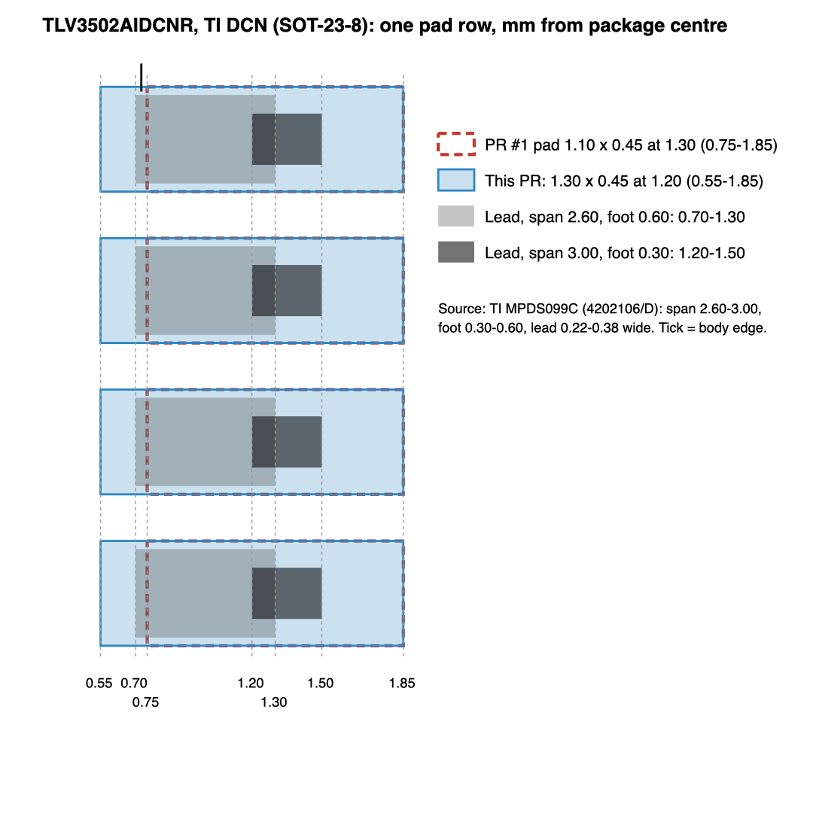

# PR #1 follow-up: the three provisional items

2026-10-26. Follows `../2026-10-26-pr1-review/report.md` ("Still open"). Done with the
`kicad-parts` skill; the three gates are at main's baseline (see Checks).

| Item | Before | Now |
|------|--------|-----|
| Harting 09231486921 land pattern | Cross-checked against KiCad's DIN 41612 footprint; dry-fit advised | **Verified** against Harting's own type 2C board-drilling drawing |
| TLV3502AIDCNR (DCN) pads | Derived from TI's DBV0006A layout; provisional | Re-derived from TI's DCN outline; **still provisional** (TI publishes no DCN land pattern) |
| XT30PW-M30.G.Y polarity | Unmarked | **Still unresolved**: the Amass spec has no +/- marking. Now flagged in the part's descriptions |

## Harting 09 23 148 6921 → verified

**Source.** Harting DIN 41612 catalogue (public, no login),
<https://b2b.harting.com/files/livebooks/en/PRD0200000100063/downloads/livebook.pdf>:
- p. 01.29 (PDF p. 57) lists 09 23 148 6921 as type 2C male, 48 contacts, angled solder pins,
  performance level 2;
- p. 01.30 (PDF p. 58) has the type 2C dimensions and **board drillings (mounting side)**.

The old `datasheets/09231486921.pdf` was the DIN Signal family sheet (doc 09031200201 rev B), which
has ratings and materials but no part drawing. That is why the review had to fall back to KiCad's
footprint. The file is now **catalogue pp. 57-58 followed by that family sheet**, so one PDF
holds the part listing, the drawing and the ratings. The verdict is recorded in
`datasheet-verdicts.json` (applied with `datasheets.py apply`, action `local-file`).

**Footprint vs. drawing** (`CONN-TH_48P-P2.54_HARTING_09231486921`, footprint frame):

| Dimension | Harting p. 01.30 | Footprint | |
|---|---|---|---|
| Contact holes | Ø1.0 ±0.1 | Ø1.0 drill, Ø1.5 pad | ✓ |
| Pitch along row | 15 × 2.54 = 38.1 | x ±19.05 | ✓ |
| Row pitch a-b-c | 2 × 2.54 = 5.08 | y +1.27 / −1.27 / −3.81 | ✓ |
| Fixing holes | Ø2.8 +0.1, 48.26 ±0.05 apart | Ø2.8 at x ±24.13 | ✓ |
| Fixing holes to row a | 2.54 ±0.1, edge side | y +3.81 (2.54 from row a) | ✓ |
| Row a to board edge | 5.3 ±0.1 | 5.3 (in the description) | ✓ |
| Pin order, mounting side | position 1 right, row a at the edge | A1 at +x, row a at +y (edge side) | ✓ |
| Pin section vs. hole | 0.6 × 0.5, about 0.78 diagonal | fits Ø1.0 | ✓ |

KiCad's `DIN41612_C2_3x16_Male_Horizontal_THT` agrees on the grid and fixing holes but puts the
board edge about 6.7 mm from row a. This footprint follows Harting's 5.3. Only the footprint
description changed (it now records the check); geometry is unchanged. The `check_models.py`
seating flag for the housing overhanging the board edge is unchanged and intended.

**Remaining:** the land pattern is checked against the manufacturer drawing; mating and assembled
fit are not checked by this.

## TLV3502AIDCNR (DCN, SOT-23-8) → re-derived, still provisional

**Source search.** The TLV3502 datasheet (SBOS321E) shows the DCN pinout and orderables but its
"Example board layout" pages cover only **D0008A (SOIC-8)** and **DBV0006A (SOT-23-6)**. TI's DCN
drawing **MPDS099C** (4202106/D, linked from ti.com/product/TLV3502) is **outline-only**: no land
pattern. Note F places DCN in **JEDEC MO-178 variation BA**. So the pads still have to be derived.

**Derivation from MPDS099C:** lead span 2.60-3.00, foot 0.30-0.60, lead width 0.22-0.38, pitch 0.65.
From the package centre, lead tips fall at 1.30-1.50 and the inner (heel) end of the foot at 0.70-1.20.

| | Pad | Covers (from centre) | Heel at 0.70 (span 2.60, foot 0.60) |
|---|---|---|---|
| PR #1 | 1.10 × 0.45 at ±1.30 | 0.75-1.85 | outside the pad by 0.05 |
| This PR | **1.30 × 0.45 at ±1.20** | 0.55-1.85 | inside, 0.15 heel margin |
| KiCad `SOT-23-8` (MO-178 BA) | 1.325 × 0.50 at ±1.1375 | 0.475-1.80 | inside |

The width (0.45, 0.20 gaps) and the toe end (1.85) are kept from PR #1; only the inner end moves in
by 0.20 so the heel gets a fillet at worst-case tolerance. The fab pin-1 mark moves with pad 1. The
description now states the source, the derivation and that it is provisional. Courtyard (±2.1) and
silk (0.10 from the pads) are unchanged. A one-footprint board with each pad on its own net gives
DRC 0.

**Remaining:** provisional until TI publishes a DCN land pattern, or one is taken from TI's
Ultra Librarian DCN model (needs a login, not done). The 3D model's 1.05 mm height noted in the
review is unchanged.

## XT30PW-M30.G.Y polarity → unresolved, now flagged

The Amass spec in `datasheets/XT30PW-M30.G.Y.pdf` (3 pp.) was re-read: product overview,
outline drawing and installation hole diagram. **None marks + or −.** Distributor pages (LCSC,
Flux, Electrokit) don't either. The symbol names pin 2 "+" and pin 1 "−", which is an
unverified assumption. Pin names are **not** changed (there is no source to change them to); the
symbol and footprint descriptions now say that polarity is provisional and must be confirmed
against the mating cable.

**Remaining:** confirm on a physical part (chamfered housing side vs. contact) and then fix the
pin names or the silk.

## Checks (on this branch)

- `datasheets.py verify`: 301 OK, 22 generic, **55 problems, the same 55 as main**; none on
  these three parts.
- `check_models.py`: identical violation list to main (stash comparison); no new findings.
- `check_nda.py --scope all`: clean; `--self-test` passes.
- `kicad-cli` parses all three footprints and the XT30 symbol; TLV3502 fixture DRC 0.
